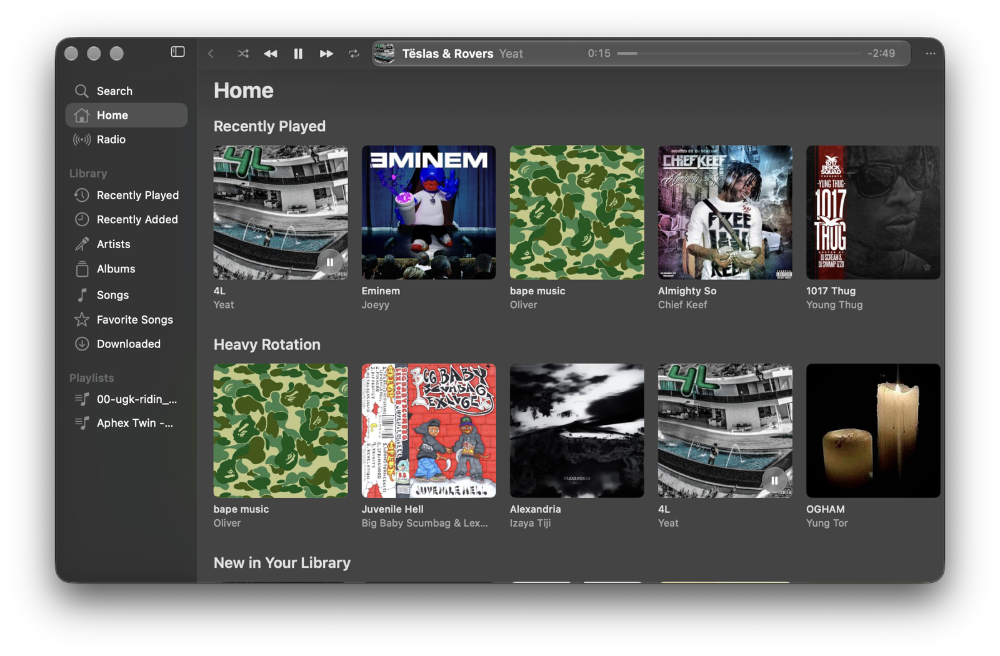

<h1 align="center">Stereo</h1>

<p align="center">A Navidrome and internet radio player for iPhone, iPad and Mac.</p>



Stereo plays your own music library from a [Navidrome](https://www.navidrome.org) server, or any other OpenSubsonic server, alongside internet radio from [Radio Browser](https://www.radio-browser.info). I wanted something that feels like Apple Music rather than Spotify, so it's native SwiftUI throughout, with Liquid Glass and Apple Music's layout. I did borrow a few of Spotify's ideas: moving playback between devices, gestures, and music that keeps going when the queue runs out.

It's a personal project first, so it's Apple-only and built for macOS and iOS 27. a GTK4 version will be worked on when the backend stabilises (and I get a new monitor)

## Install

There's no release yet, so for now you'll need to build it yourself (see [Building](#building)). You'll need iOS 27, iPadOS 27 or macOS 27.

When you first open it, sign in with your server's address and your Navidrome username and password. You can give it a second address too, say one for home and one for when you're out, and it'll use whichever one answers.

## Library

Home has shelves for Recently Played, Heavy Rotation, Rediscover and New in Your Library. If you connect [ListenBrainz](https://listenbrainz.org) in Settings, you also get For You, Weekly Jams and Weekly Exploration, matched against what's actually in your library.

Playback is gapless, with ReplayGain by track or album. You can stream originals or transcodes, with separate quality settings for Wi-Fi and cellular. Tracks start playing while they download, and recent ones are cached so they don't download again.

You can download albums and playlists for offline listening. Downloaded playlists pick up new tracks as they're added. Search works offline too, and doesn't care about accents.

Lyrics are synced if your server has them. Stars, playlists and play counts all live on Navidrome, and plays are scrobbled through it, so Navidrome passes them on to Last.fm or ListenBrainz if you've set that up.

When the queue runs out, Stereo can keep going with similar music from your own library, using Navidrome's similar songs first and then ListenBrainz's similar artists.

## Radio

Radio is its own section, like in Apple Music. You can search all of Radio Browser with filters, for example `jazz codec:flac bitrate>=256 country:IE #chill`, or add your own stream URL, including `.pls`, `.m3u` and HLS.

While a station plays, Stereo reads the song title from the stream and finds artwork for it. If the song is in your library, you can jump straight to it. Identify uses Shazam on the audio Stereo is already playing, so it doesn't need the microphone.

Favourite stations and your settings sync between your devices through iCloud.

## Moving between devices

Any Stereo on your local network can control another one, or hand over what it's playing. Start an album on your phone, send it to the Mac, and it carries on from the same spot. You can also pull the Mac's music back to your phone. Devices find each other automatically and trust each other through a key kept in iCloud Keychain, so there's no pairing step. They have to be signed in to the same Navidrome account.

It only works on the same network for now.

## Mac

The Mac app is a proper Mac app, not an iPad-style one. The player sits in a slim bar at the top of a glass window, with lyrics and the queue in a side panel. Albums, artists and playlists can open in their own windows, and there's a mini player in the menu bar.

A few shortcuts worth knowing:

- Space plays and pauses, unless you're typing.
- ⌘← and ⌘→ skip, and ⌘↑ and ⌘↓ change the volume.
- ⌘F searches, ⌘L shows lyrics and ⌥⌘U shows the queue.
- ⌥⌘P opens the full Now Playing view.

## Everything else

- Siri and Shortcuts can play an album, artist, playlist or station, shuffle your library, play and pause, and identify a song.
- Albums, artists, playlists and favourite stations show up in Spotlight.
- There are widgets for Now Playing, Recently Played and Your Stations. Tapping an album or station starts it without opening the app.
- Control Center, the Lock Screen, media keys and AirPods all work as you'd expect.

## Building

You'll need Xcode 27 and [XcodeGen](https://github.com/yonaskolb/XcodeGen).

```sh
xcodegen generate
open Stereo.xcodeproj
```

Before you build to a device, change `DEVELOPMENT_TEAM` and `STEREO_BUNDLE_PREFIX` near the top of `project.yml` to your own team and a bundle ID you own. The iCloud container, App Group and Keychain group all follow from those two.

If you just want to try the Mac app without setting up signing, you can do an ad-hoc build. iCloud sync, widgets and moving between devices won't work in it, but everything else will.

```sh
xcodebuild -project Stereo.xcodeproj -scheme Stereo-macOS -destination 'generic/platform=macOS' \
  CODE_SIGN_IDENTITY=- CODE_SIGN_STYLE=Manual DEVELOPMENT_TEAM= \
  CODE_SIGN_ENTITLEMENTS="$PWD/Apps/macOS/Stereo-Local.entitlements" build
```

Everything except the views lives in a Swift package in `StereoKit`, split into modules for the server client, library database, playback engine, radio, device handoff and so on. The apps in `Apps/` are thin. To run the tests:

```sh
cd StereoKit && swift test
```

The integration tests need a real Navidrome. `scripts/make-test-library.sh` makes a small tagged library to point one at:

```sh
scripts/make-test-library.sh /tmp/stereo-music
STEREO_IT_URL=http://127.0.0.1:4533 STEREO_IT_USER=… STEREO_IT_PASS=… swift test --filter IntegrationTests
```

Debug builds sign in on their own if `STEREO_DEV_URL`, `STEREO_DEV_USER` and `STEREO_DEV_PASS` are set. For the simulator, prefix them with `SIMCTL_CHILD_`.

The app icon is an Icon Composer file generated by `scripts/make-icon.py`.

## What's next

Testing device handoff properly on real hardware, a better device picker, dragging songs out of the Mac app into Finder, an iPad version, and then crossfade, EQ and a sleep timer. Apple TV maybe after that. Linux and Android after that. I'm not planning a Windows version.

## License

Stereo is licensed under the [MIT License](LICENSE).
